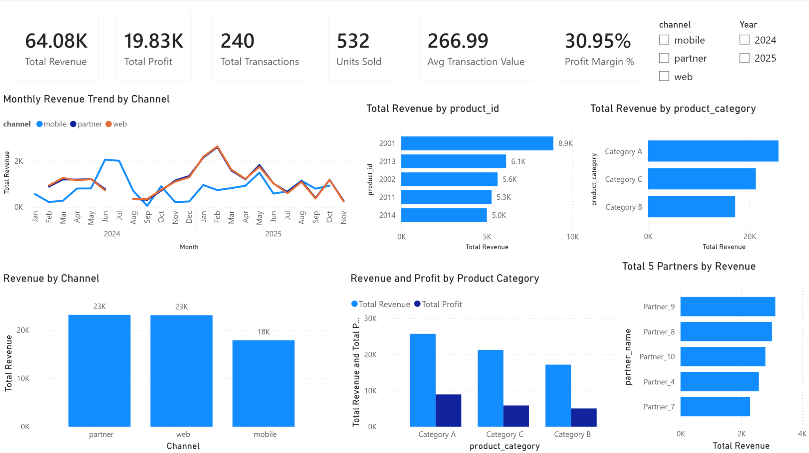
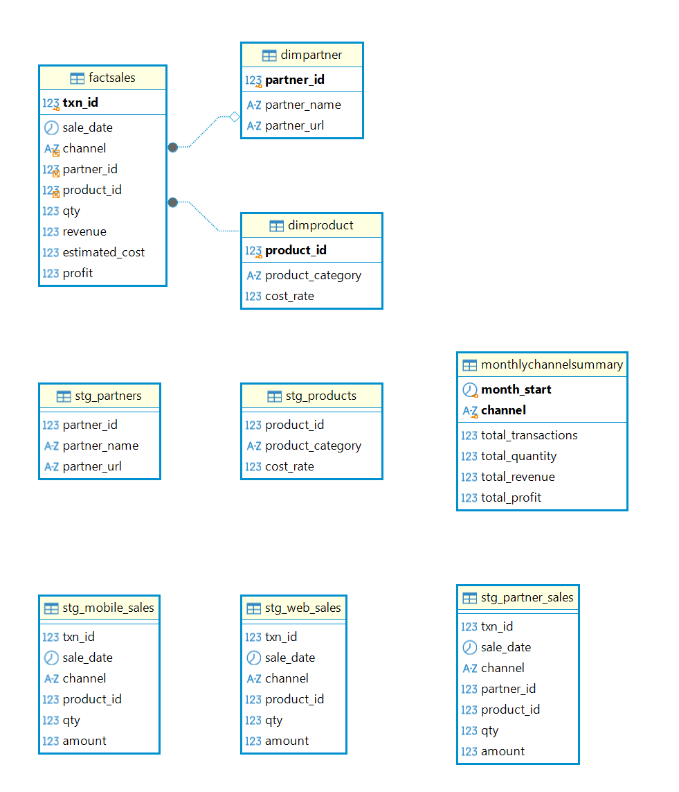

# E-Commerce Multi-Channel Analytics

**MySQL · DBeaver · Power BI | Academic analytics project · 2026**

An end-to-end analytics solution for a fictional online retailer operating across **web, mobile, and partner-site sales channels**. The project integrates differently formatted source files into a relational analytical database, validates transaction quality, answers business questions with SQL, and presents the results in an interactive Power BI dashboard.

I designed and implemented the database, staging and ETL workflow, data-quality checks, SQL analyses, query optimization and role-based access demonstration, and developed the Power BI dashboard and project documentation.

> **Data context:** This is a demonstration of an analytical workflow, not a study of a real retailer. It uses course-provided fictional data together with supplemental data created for the project. Product-category assignments and cost rates are modelling assumptions.

## Dashboard



**[Download the Power BI report (.pbix)](powerbi/ecommerce_dashboard.pbix)** to explore its visuals, measures, and model in Power BI Desktop. Refreshing data may require updating the original local MySQL/ODBC connection settings.

## Key results

| Measure | Project result |
| --- | ---: |
| Sales transactions | 240 |
| Units sold | 532 |
| Total revenue | $64,077.75 |
| Estimated profit | $19,829.32 |
| Estimated profit margin | 30.95% |
| Average transaction value | $266.99 |

### Illustrative findings

- **Channel performance:** Partner sales generated **$23,141.72** in revenue, narrowly ahead of web sales at **$23,058.24**. Mobile sales generated **$17,877.79**, despite recording the greatest number of units sold.
- **Product categories:** Category A generated the most revenue (**$25,697.23**). The category labels are supplemental analytical classifications, not verified retail product categories.
- **Reporting:** The dashboard allows exploration of monthly revenue trends, channel performance, leading products and categories, partner performance, and estimated profitability.

Because partner transactions were supplemented and product costs were estimated, these results illustrate the analytical process rather than independently verified commercial performance.

## Data architecture and methodology



1. **Stage:** Import five source inputs into dedicated staging tables for web sales, mobile sales, partner information, partner sales, and product metadata.
2. **Validate:** Profile nulls, duplicate identifiers, nonpositive quantities, negative amounts, inconsistent channel labels, out-of-range cost rates, and unmatched product IDs.
3. **Transform:** Standardize channel values using `LOWER(TRIM(...))`; consolidate transactions with `UNION ALL`; calculate transaction-level estimated costs and profit using supplemental product cost rates.
4. **Model:** Create a `FactSales` fact table related to `DimProduct` and `DimPartner`; use a dedicated date table in the Power BI reporting model.
5. **Analyze:** Write SQL for channel revenue, monthly trends, month-over-month growth with `LAG()`, products, partners, weekday patterns, and category profitability.
6. **Optimize:** Compare MySQL `EXPLAIN` plans before and after adding a composite `(channel, sale_date)` index; create a persisted `MonthlyChannelSummary` aggregate and refresh procedure.
7. **Report:** Connect Power BI to the analytical model via ODBC, create DAX measures, and build a one-page interactive dashboard.

The index comparison demonstrates query-plan inspection on a **240-transaction sample**, not a measured performance improvement at production scale.

## Technologies

- **MySQL Community Edition:** relational schema design, ETL, joins, window functions, data validation, indexing, stored procedures, role-based access control
- **DBeaver Community Edition:** source import, SQL execution, database inspection, validation, and testing
- **Power BI Desktop:** MySQL/ODBC connectivity, relationships, date dimension, DAX measures, slicers, and interactive visualizations

## Data sources

The repository includes all five import-ready CSV datasets. The original mobile-sales spreadsheet and partner HTML table were converted to CSV for import into MySQL using DBeaver Community Edition.

| File | MySQL staging table |
|---|---|
| `data/web_sales.csv` | `stg_web_sales` |
| `data/mobile_sales.csv` | `stg_mobile_sales` |
| `data/partners.csv` | `stg_partners` |
| `data/partner_sales.csv` | `stg_partner_sales` |
| `data/products.csv` | `stg_products` |

**Import column mappings:** When importing the CSV files into MySQL using DBeaver, map the `date` column to `sale_date` in the web, mobile, and partner sales tables. For the partners dataset, map `name` to `partner_name` and `url` to `partner_url`. These mappings align the source columns with the staging-table definitions.

**Assumptions:** Product categories and cost rates (0.62–0.78) were added to support estimated-profit calculations; they are not original source-system facts. No fixed unit selling price was assumed from the varying transaction amounts.

## Repository structure

```text
.
├── README.md
├── .gitignore
├── assets/
│   ├── data_model.png
│   └── powerbi_dashboard.png
├── data/
│   ├── web_sales.csv
│   ├── mobile_sales.csv
│   ├── partners.csv
│   ├── partner_sales.csv
│   └── products.csv
├── powerbi/
│   └── ecommerce_dashboard.pbix
└── sql/
    ├── ecommerce_multichannel_analytics.sql
    └── security_demo.sql
```

## Reproduce the analysis

**Prerequisites:** MySQL Community Edition, DBeaver or another MySQL-compatible SQL client, and (to explore the dashboard) Power BI Desktop. The source files listed above are provided in `data/`.

1. In your own MySQL environment, open [`sql/ecommerce_multichannel_analytics.sql`](sql/ecommerce_multichannel_analytics.sql) and execute **Section 1 only** to create the `ecommerce_analytics` database and its staging tables.
2. The five import-ready CSV files are provided in the `data/` directory. Use the mapping in the **Data sources** section above to identify the corresponding MySQL staging table for each file.
3. Import the five prepared CSV files into their matching `stg_*` tables using DBeaver. Verify column types and row counts before continuing.
4. Execute the remaining SQL sections in order: validation, dimensional and fact-table loading, business analysis, indexing, and persisted monthly summary. Review each set of validation results.
5. Open [`powerbi/ecommerce_dashboard.pbix`](powerbi/ecommerce_dashboard.pbix) in Power BI Desktop. The saved report can be inspected there; to **refresh** it against a newly rebuilt database, update the MySQL/ODBC data-source connection for your environment as needed. Credentials and machine-specific configurations are not provided.
6. The optional [`sql/security_demo.sql`](sql/security_demo.sql) illustrates least-privilege database roles. **Do not run its account creation, role, or `DROP` statements on a shared or production server.** Use local credentials without committing them to Git.

The project results above are taken from the completed project analysis. Reproduction should be checked against the original source files, SQL version, and local database configuration; it has not been independently retested in a fresh environment as part of this repository publication.

## Limitations and next steps

- The dataset contains **80 web**, **80 mobile**, and **80 supplemental partner transactions**, making it suitable for a demonstration rather than production forecasting.
- Synthetic partner transactions, product categories, and cost assumptions enable comparisons but should not be represented as actual business facts.
- The observed monthly patterns should not be extrapolated into real-world commercial trends.
- Index effectiveness should be reassessed against a larger representative dataset and measured execution times.
- A future version could automate ingestion, validation and refreshes, include rejected-record reporting, and replace assumptions with authoritative product costs and partner feeds.
